# API pagination lab

How to pull a million records from a REST API without losing one.

A first call often returns 1,000 rows and stops. Paging the rest can take an hour. This lab builds a painful local API, then every common way of walking it, then measures them. Nothing in the tables below is invented. The run that produced them is in [results/benchmark.md](results/benchmark.md).

Live walkthrough: [https://manzoor25.github.io/api-pagination-lab/](https://manzoor25.github.io/api-pagination-lab/)

## Quick start

Windows:

```powershell
.\run.ps1 setup
.\run.ps1 api
.\run.ps1 demo
```

macOS or Linux:

```bash
make setup
make api
make demo
```

`api` starts the local server on port 8000 with 1,000,000 rows, a 1,000-row cap, and 300 ms of latency. `demo` uses a smaller server so you can see truncation, a real process kill, live-data drift, an incremental delta, and a rate-limit contrast in about a minute. `.\run.ps1 benchmark` repeats the measured table. `.\run.ps1 real` pulls FDIC BankFind. `.\run.ps1 test` runs ruff and pytest.

## What you should see

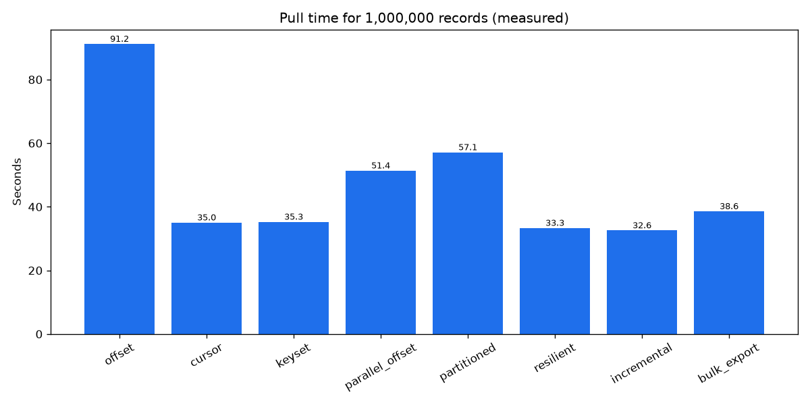

1,000,000 rows, page size 1,000, latency injection off, so this is SQLite plus HTTP plus writing Parquet. Not the 300 ms server.

| strategy | seconds | requests | records/sec | retries | duplicates | missing |
| --- | ---: | ---: | ---: | ---: | ---: | ---: |
| naive | 0.25 | 2 | 4006.9 | 0 | 0 | 999000 |
| offset | 91.20 | 1000 | 10964.8 | 0 | 0 | 0 |
| cursor | 35.04 | 1000 | 28539.1 | 0 | 0 | 0 |
| keyset | 35.27 | 1000 | 28350.6 | 0 | 0 | 0 |
| parallel_offset | 51.37 | 1000 | 19466.4 | 0 | 0 | 0 |
| partitioned | 57.11 | 1000 | 17510.4 | 0 | 0 | 0 |
| resilient | 33.34 | 1000 | 29992.8 | 0 | 0 | 0 |
| incremental | 32.56 | 1001 | 30709.2 | 0 | 0 | 0 |
| bulk_export | 38.57 | 17 | 25928.2 | 0 | 0 | 0 |

Naive is supposed to miss 999,000 rows. That is the bug the lab starts from.

Offset took 91 seconds. Keyset took 35. A probe of the same SQLite file: `OFFSET 900000` was 126.4 ms, `WHERE id > 900000` was 0.3 ms. Parallel offset did not win, because with no network latency the expensive skips contend and Parquet writing dominates. Threads help when each call costs hundreds of milliseconds and you are under the rate limit. They do not help when the limit is already the ceiling.

On the default 300 ms server, 20 measured pages took 6.96 seconds, 0.348 seconds each. Calculated, not measured: 1,000 pages at that cost is 348 seconds. The same per-request cost at page size 100 is about 58 minutes. That is the hour.

Other measured contrasts, from `demo`:

- Incremental: 5,000 rows, then 40 touched, then 40 rows in 0.251 seconds.
- Live updates: offset produced 14 duplicate ids. Keyset produced 0.
- Hard kill after 5 pages, then rerun: 2,000 unique ids, 0 duplicates.
- 20 threads against 5 requests/second: 30 retries. A client limiter at 4/second: 0 retries. Both landed every row.

FDIC BankFind, no key, documented max page size 10,000: 27,835 institutions, 3 requests, 2.9 seconds, 0 duplicates. Details in [results/fdic.md](results/fdic.md).

## Pictures

Sequential, one page in flight:

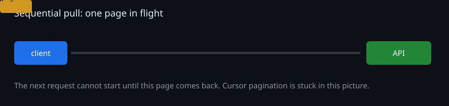

Concurrent lanes. Useless for a cursor, useful for keyset ranges, still capped by the rate limit:

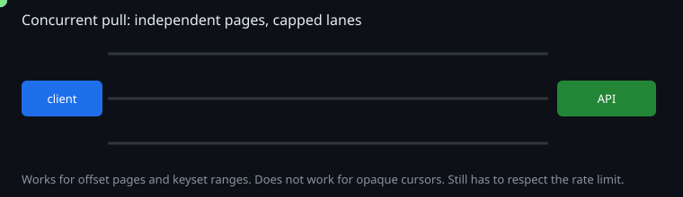

Extra threads bouncing off a limit:


A hard kill, then resume from the last checkpoint:

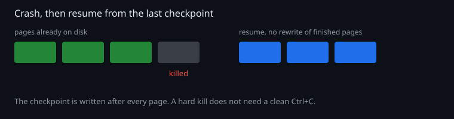

Pages landing on disk as they arrive:

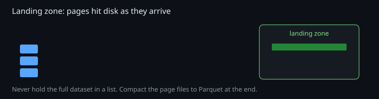

Open the SVG files in a browser if the README shows only the first frame. The [site](https://manzoor25.github.io/api-pagination-lab/) animates the same ideas and has a slider for the time formula.

## How a page moves

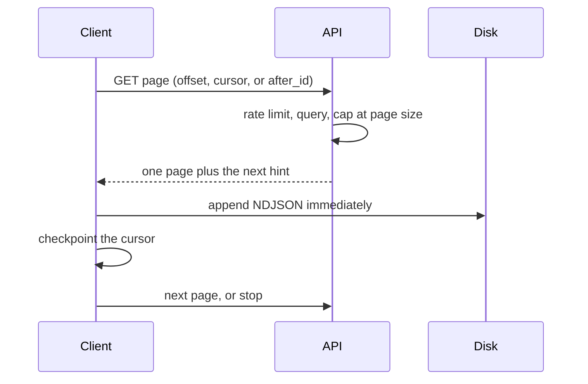

Offset:

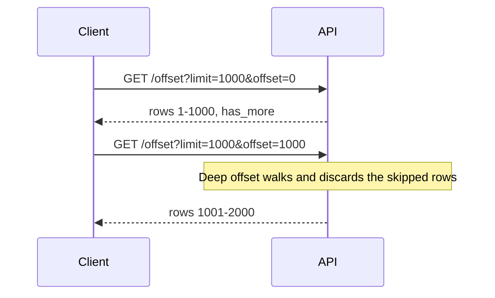

Cursor. Page 2 cannot start until page 1 mints the token:

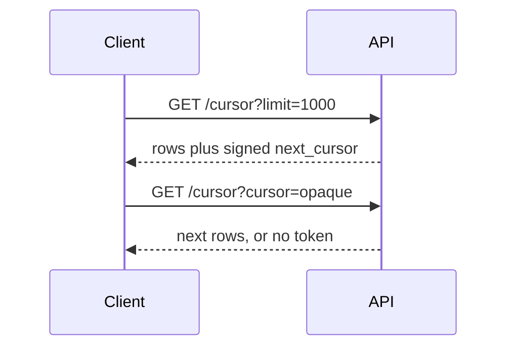

Keyset. The client names the last id, so ranges can run together:

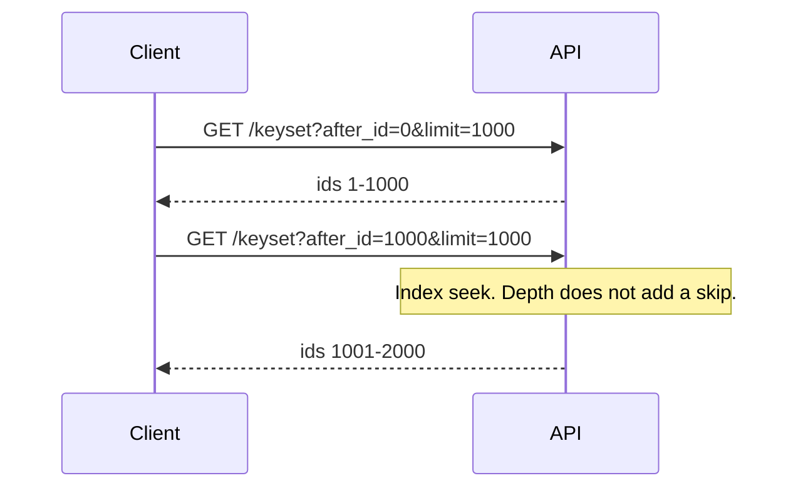

## Which approach

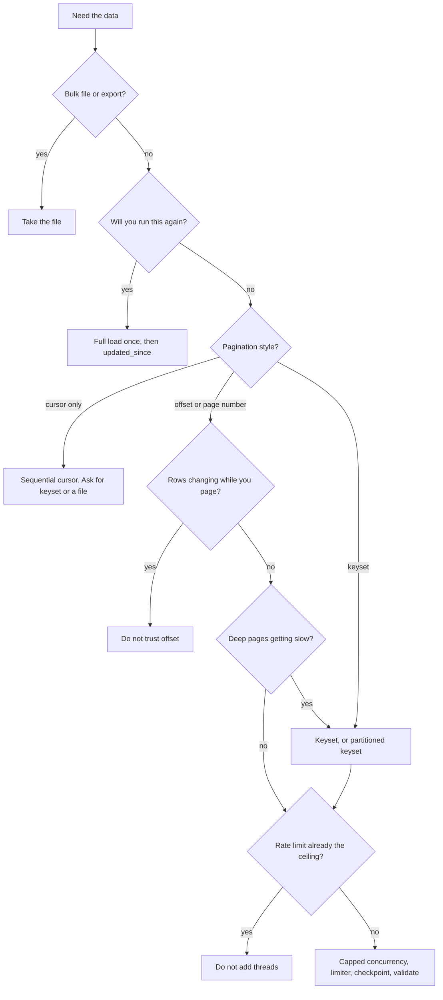

## Architecture

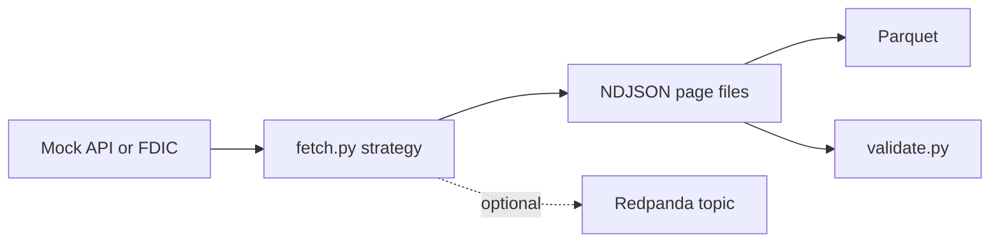

## Layout

| Path | What it teaches |
| --- | --- |
| [mock_api/server.py](mock_api/server.py) | The painful API: cap, latency, deep offset, 429s, failures, live drift, export |
| [fetch.py](fetch.py) | One command, nine strategies |
| [validate.py](validate.py) | Duplicates, gaps, count versus the API |
| [diagnose.py](diagnose.py) | Where the time goes, in one paragraph |
| [benchmark.py](benchmark.py) | The table above |
| [real_api/fdic.py](real_api/fdic.py) | Working no-key FDIC adapter |
| [real_api/TEMPLATE_adapter.py](real_api/TEMPLATE_adapter.py) | Fill-in sheet for your team's API |
| [docs/LEARNING.md](docs/LEARNING.md) | The course, including 25 interview questions |
| [docs/API_GUIDE.md](docs/API_GUIDE.md) | How to read pagination docs, including `startIndex` / `resultsPerPage` |
| [site/index.html](site/index.html) | The static walkthrough |
| [kafka_bridge/](kafka_bridge/) | Optional. Off unless you start Docker |

## Commands after the first three

```powershell
.\run.ps1 test
.\run.ps1 benchmark
.\run.ps1 real
python fetch.py --strategy keyset --page-size 1000
python validate.py --run-dir data\landing\keyset\<run-id> --base-url http://127.0.0.1:8000
python diagnose.py --preset mock
```

The course is [docs/LEARNING.md](docs/LEARNING.md). A LinkedIn draft is [docs/LINKEDIN_POST.md](docs/LINKEDIN_POST.md).
