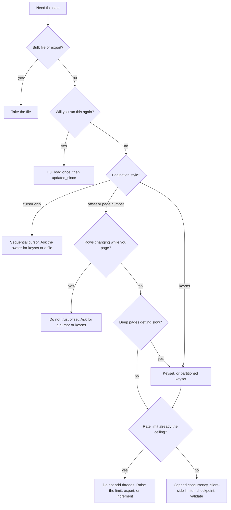

# Pulling a large API without losing rows

This is the course for the lab. Read it once, then run the scripts. The scripts are the point. This file tells you what to look at while they run.

## Why APIs limit records per call

A teammate calls `GET /orders` and gets 1,000 rows. The table has a million. The cap is deliberate.

A single response that holds every row:

- can exhaust the API server's memory while it builds the JSON
- can run past the gateway timeout, so the client retries and the server does the work twice
- lets one caller starve everyone else sharing the process
- is expensive to retry, because a dropped connection throws away the whole body

So the server says "1000 is the most I will put in one response." That is not the server telling you there are only 1000 rows. It is the server telling you to come back.

`mock_api/server.py` returns HTTP 400 if you ask for more than the cap, and it includes those reasons in the body. `python fetch.py --strategy naive` prints them.

## Each pagination style

### Offset / limit

```python
offset = 0
while True:
    page = get("/offset", limit=1000, offset=offset)
    write(page)
    if not page["has_more"]:
        break
    offset += len(page["data"])
```

You say "skip 500000, then give me 1000." The database often still walks those 500000 index entries and throws them away. On this lab's SQLite file, `OFFSET 900000` took about 126 ms and `WHERE id > 900000` took about 0.3 ms. Same rows. Different plan.

Offset is also wrong if the table changes while you walk it. "Skip 1000" means "skip whatever is in position 1000 right now," not "continue after the last id I saw."

Page numbers are the same idea. `page=2, page_size=1000` is `offset=1000`. Watch the off-by-one: this server uses page 1 as the first page and rejects page 0.

### Cursor

The response contains an opaque `next_cursor`. You send it back. You do not parse it. This server signs the token, so a forged cursor is HTTP 400.

You cannot parallelize a cursor walk. Page 5's token does not exist until page 4 has been generated. You also cannot jump to the middle, which is why you cannot split a cursor walk into ranges.

Cursor walks are consistent if the token means "the last key I returned," not "skip N rows."

### Keyset

```python
after_id = 0
while True:
    page = get("/keyset", limit=1000, after_id=after_id)
    write(page)
    if not page["has_more"]:
        break
    after_id = page["data"][-1]["id"]
```

`WHERE id > ? ORDER BY id LIMIT ?` is an index seek. The cost does not grow as you get deeper. Because `after_id` is a real column, you can start a second loop at `after_id=500000` and stop it at `end_id=750000`. That is partitioning.

### Link header

RFC 5988 puts the next URL in a header:

```
Link: <https://api.example/linkheader?cursor=...>; rel="next"
```

Clients that only look at the JSON body stop after page 1. That is a quiet way to lose data. `GET /linkheader` on the mock server sets this header.

### startIndex / resultsPerPage

Same as offset, different names. `startIndex` is how many rows to skip. Confirm whether it is zero-based. `resultsPerPage` is the page size. The NVD CVE API uses this shape. See [docs/API_GUIDE.md](API_GUIDE.md).

## What happens on each page

1. Your process opens (or reuses) a connection and sends one request.
2. The server waits out any artificial latency, checks the rate limit, and runs one query.
3. It returns one page, plus a hint: a next offset, a cursor, or an empty page.
4. Your process writes that page to disk immediately, as NDJSON.
5. It prints pages, records, requests per second, retries, elapsed time, and ETA.
6. It sends the next request.

Records accumulate on disk, not in a Python list. A crash at page 900 keeps the first 900 pages. `fetcher/landing.py` then compacts those files to Parquet without holding every row as one giant list of dicts. Dedup, if you ask for it, keeps the newest `updated_at` for each `id`.

## Why the hour happens

Write the formula down before you add threads:

```
pages        = ceil(total_records / page_size)
sequential   = pages * latency_per_request
with_threads = sequential / concurrency
rate_floor   = pages / allowed_requests_per_second
actual       = max(with_threads, rate_floor)
```

A million rows at 1,000 per page is 1,000 requests.

- At 300 ms each, sequential is 300 seconds, about 5 minutes, before deep-offset cost and retries.
- At 100 per page, it is 10,000 requests. At 360 ms each, that is 3,600 seconds. One hour.
- At a government-style limit of 5 requests per 30 seconds, 1,000 pages take 6,000 seconds. Threads do not change that. They only create 429s.

The lab's painful sample measures the 300 ms server and multiplies. That product is labeled as a calculation in `results/benchmark.md`. The million-row table next to it is a real run, with latency injection turned off, so you can see SQLite's own offset cost.

`python diagnose.py` prints the same formula against whatever API you point it at.

## What actually makes it faster

Use these in this order. Most teams start at the bottom.

| Lever | When it helps | When it does not |
| --- | --- | --- |
| Larger page size | You are below the documented maximum | You are already at the cap |
| Field selection | The payload is wide and you need a few columns | You need every column |
| Gzip | Responses are large and the server supports it | The body is already tiny |
| Connection reuse | You are paying a new TCP/TLS handshake per page | You already use a pooled client |
| Keyset instead of deep offset | Offset time grows with depth | The API only offers offset or cursor |
| Concurrency | Pages are independent and you are under the rate limit | The walk is a cursor, or you are already at the limit |
| Partitioning | You can cut id or date ranges and seek inside each | The only token is an opaque cursor |
| Incremental `updated_since` | You will run this again tomorrow | You need the full history once |
| Bulk export | The API offers a file or job | It does not |
| A higher limit from the owner | The rate limit is the ceiling | You have not measured yet |

In the demo, 20 concurrent pages against a 5 request/second server produced 30 retries. The same pull with a client-side limiter at 4/second produced 0 retries and still landed every row. That is the whole concurrency lesson.

## Data safety

**Checkpoint.** Write the page file, then write a small JSON file with the last id. Name the page file after the cursor, and overwrite it on resume. A hard kill does not need a clean Ctrl+C. The demo kills the process with `kill()` and the rerun finishes at the right count with zero duplicate ids.

**Retries.** Retry 429, 500, 502, 503, 504, timeouts, and connection drops. Do not retry 400. Wait at least `Retry-After`. Otherwise wait with exponential backoff and jitter, so a fleet of clients does not wake up together.

**Idempotent writes.** Applying the same page twice must end at the same rows. The rule in this lab: primary key is `id`; if two versions exist, keep the greater `updated_at`.

**Validation.** `validate.py` compares the landed unique ids with the API's `/count`, reports duplicate ids, and reports missing id ranges when the ids are supposed to be dense. A pull that "finished" can still be wrong. This script is the definition of done.

**Live changes.** Offset pagination of a mutable sort order duplicates and skips. In the demo, an offset walk while rows were moving landed 14 duplicate ids and missed rows that a keyset walk of the same moment still returned, with zero duplicates. Keyset and cursor keyed by `id` do not care that `updated_at` jumped.

## Which approach should I use?



## Measured results

Full table, 1,000,000 rows, page size 1,000, latency injection off. Seconds include writing Parquet. Source: [results/benchmark.md](../results/benchmark.md).

| strategy | seconds | requests | records/sec | retries | duplicates | missing |
| --- | ---: | ---: | ---: | ---: | ---: | ---: |
| naive | 0.25 | 2 | 4006.9 | 0 | 0 | 999000 |
| offset | 91.20 | 1000 | 10964.8 | 0 | 0 | 0 |
| cursor | 35.04 | 1000 | 28539.1 | 0 | 0 | 0 |
| keyset | 35.27 | 1000 | 28350.6 | 0 | 0 | 0 |
| parallel_offset | 51.37 | 1000 | 19466.4 | 0 | 0 | 0 |
| partitioned | 57.11 | 1000 | 17510.4 | 0 | 0 | 0 |
| resilient | 33.34 | 1000 | 29992.8 | 0 | 0 | 0 |
| incremental | 32.56 | 1001 | 30709.2 | 0 | 0 | 0 |
| bulk_export | 38.57 | 17 | 25928.2 | 0 | 0 | 0 |

A separate run with the default 300 ms latency measured 0.348 seconds per page over 20 pages. Calculated, not measured: 1,000 such pages is 348 seconds. The same per-request cost at page size 100 is about 58 minutes.

What this machine showed:

- Naive lands one page and stops. The missing count is almost the whole table.
- Offset of a million ids is slower than keyset, even with the artificial latency turned off, because SQLite walks the skipped rows.
- Cursor and keyset return the same rows. Cursor cannot be split. Keyset can.
- Parallel offset and partitioned keyset beat the sequential loops when the rate limit is off.
- A client-side limiter removes 429 retries that uncapped concurrency creates. That comparison is in `results/demo.json`, not in the timing table, because the timing table turns the limiter off on purpose.
- Incremental's second run is the size of the delta. In the demo, a 5,000-row first load was followed by a 40-row second load after 40 rows were touched.
- Bulk export avoids the per-page round trip. On a zero-latency local server it is not magic. On a 300 ms server it is, because you stop paying 300 ms a thousand times.

## Common mistakes

- Treating a 1,000-row response as the whole table.
- Stopping when `offset >= total_from_the_first_response`. That total is already stale if the table is live. Stop on an empty page or `has_more=false`.
- Advancing by the requested page size when the page came back short.
- Page 0 versus page 1.
- Parallelizing a cursor.
- Retrying HTTP 400.
- Retrying HTTP 429 immediately, with no jitter.
- Holding every page in a list "just until the end."
- Checkpointing only in a `finally` block. A hard kill skips `finally`. Checkpoint every page.
- Deduping on id and throwing away `updated_at`, so a retry keeps the old version.
- Trusting a row count without checking duplicate ids and gaps.
- Adding threads because the pull is slow, before reading the rate-limit header.

## 25 interview questions

1. **Why does an API cap the page size?** Memory, gateway timeouts, fairness, and the cost of retrying a huge body.
2. **What is the difference between offset and keyset?** Offset skips N rows in the current order. Keyset seeks to the last key you saw. Offset gets slower with depth and drifts if rows move. Keyset stays fast and stable for that key.
3. **Why can't you parallelize a cursor?** The next token is produced by the previous response, and a signed token cannot be forged.
4. **When is parallel offset safe?** When each page is addressed by its own offset, the table is not changing, and you stay under the rate limit. It is still the wrong tool if rows are moving.
5. **What does `Retry-After` mean?** The earliest time you should send another request. Ignoring it turns a 429 into a retry storm.
6. **Why add jitter to backoff?** So many clients that failed together do not retry together and fail again.
7. **Which status codes are retryable?** 429, 500, 502, 503, 504, timeouts, connection resets. Not 400, 401, 403, 404.
8. **What is an idempotent write?** Doing it twice leaves the same rows. Here that means dedup on primary key, keeping the newest `updated_at`.
9. **Why checkpoint the cursor and not just the page count?** Page count is not a resume point for keyset. The last id is. For offset, the next offset is the resume point, and it is still wrong if the table changed.
10. **Why write the page file before the checkpoint?** If you die between them, the next run overwrites that same file. If you checkpoint first and die before the write, you skip a page.
11. **How do you detect a lost row?** Stream the landed ids, compare unique count to the API total, and scan for gaps if ids are dense. A finished process is not proof.
12. **Why can offset duplicate a row it already returned?** A row inserted, or moved, into the already-consumed part of the sort shifts the tail left. The next "skip N" lands on a row you have seen, and a row that jumped backward is never visited.
13. **What is a watermark?** The server time at the start of a successful run. The next run asks for rows updated at or after that time. Using "the max `updated_at` I happened to see" can skip a row committed during the run.
14. **Why is the first incremental load slow and the second fast?** The first load has no watermark, so it is the full table. The second is the delta. In the demo, 5,000 then 40.
15. **When does concurrency stop helping?** When `pages / rate_limit` is larger than `pages * latency / concurrency`. Past that point, threads buy 429s.
16. **What is the difference between a client limiter and the server limiter?** The server limiter is the law. The client limiter is you obeying it before the 429. You still need retries, because other clients share the server budget.
17. **Why stream pages to disk?** Memory stays flat, a crash keeps finished pages, and validation can rescan without another pull.
18. **Why Parquet at the end and NDJSON in the middle?** NDJSON is a trivial crash-safe page. Parquet is what you want to scan later. Compacting at the end means a crash does not lose the pages.
19. **What does a Link header change?** Nothing about the data. Everything about the client. If you ignore the header, you stop early.
20. **How do you find the pagination style in docs you have never seen?** Look for offset/limit, startIndex/resultsPerPage, page/pageSize, cursor/next, or a Link header. Request two pages. If the second request needs a token from the first, it is a cursor.
21. **A header says the limit is 20. What do you still not know?** The window. 20 per second and 20 per minute are different systems. Do not invent the window.
22. **When would you put API pages into Kafka?** Many consumers, replay, or a split between the team that pulls and the team that loads. Not when one script writes one file.
23. **What is the failure mode of "count the rows and compare to total" alone?** Duplicates can make the count match while rows are missing. Check unique ids, not just the raw count.
24. **Why include `id` even when the caller asked for other fields?** Without the key you cannot dedup, resume, or do keyset. Hiding it manufactures data loss.
25. **What do you ask the API owner if the pull takes an hour?** The maximum page size and whether you are using it. The rate-limit window, not just the number. Whether a bulk export or an `updated_since` filter exists.

## Run it

From the repo root, on Windows:

```
.\run.ps1 setup
.\run.ps1 api
.\run.ps1 demo
```

`demo` is the small teaching run: truncation, a real process kill, live-data drift, a 40-row incremental delta, and the 429 contrast. `benchmark` is the measured table. `real` diagnoses FDIC BankFind and pulls the institutions collection at the documented maximum page size of 10,000.
